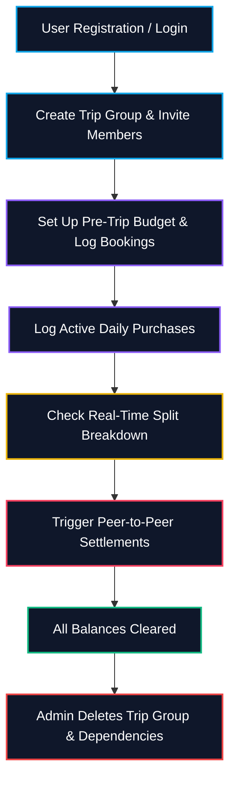
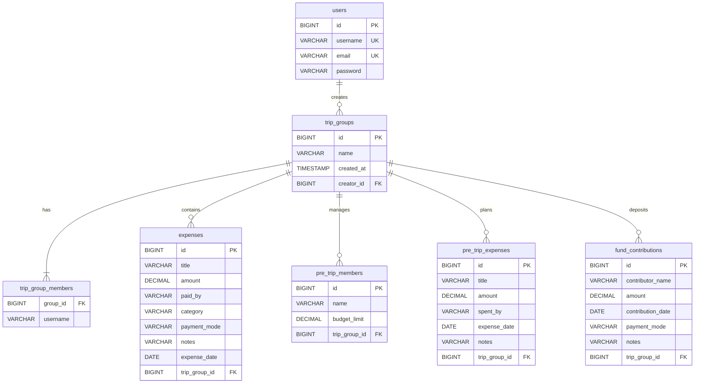

<div align="center">


[](https://openjdk.org/)
[](https://spring.io/projects/spring-boot)
[](https://www.postgresql.org/)
[](https://maven.apache.org/)
[](https://www.docker.com/)

[](https://tour-expence-tracker-frontend.vercel.app/)
[](https://github.com/ashrithBalaji456/Tour_Expence_Tracker_Frontend)

</div>

---

## ✈️ About

This repository contains the backend REST API engine for the **Tour Expense Tracker** application. It handles user authentication, group expense sharing, pre-trip planning logistics, real-time peer-to-peer debt settlements, and group fund deposits.

🔗 **Live Application:** [tour-expence-tracker-frontend.vercel.app](https://tour-expence-tracker-frontend.vercel.app/)
🔗 **Frontend Repo:** [Tour_Expence_Tracker_Frontend](https://github.com/ashrithBalaji456/Tour_Expence_Tracker_Frontend)

---

## 🚀 Architectural & User Workflow



---

## 🛠️ Feature Highlights

- **Secure JWT Authentication** — stateless session security with custom filters, 24-hour token duration
- **Trip Group Scope Isolation** — multi-user invitations; custom filters auto-detect group context from request headers to partition expenses cleanly
- **Dual-Phase Split Tracking**
  - *Pre-Trip Planning*: bookings like flights/hotels calculated separately against upfront budget caps
  - *Active Group Spends*: shared purchase splits, cash pool deposits, peer settlements
- **Self-Healing Constraint Schema** — custom SQL patches automatically execute on startup to self-heal constraint validations
- **P2P Settlement Algorithm** — optimized grid matching engine that computes the minimum number of cash transfers required to settle the group

---

## 🧮 Settlement Algorithm Logic


---

## 🗄️ Database Entity Schema (PostgreSQL)



---

## 🔌 API Endpoints

| Category | HTTP Method | Endpoint | Authorization | Description |
| :--- | :--- | :--- | :--- | :--- |
| **Auth** | `POST` | `/api/auth/register` | PermitAll | Register a new user account |
| **Auth** | `POST` | `/api/auth/login` | PermitAll | Login user & retrieve JWT bearer token |
| **Group** | `POST` | `/api/auth/group` | Authenticated | Create a new trip group & invite members |
| **Group** | `GET` | `/api/auth/groups` | Authenticated | Retrieve all trip groups the user is part of |
| **Group** | `DELETE` | `/api/auth/group/{id}` | Authenticated (Admin) | Delete a trip group and clear all related data |
| **Dashboard** | `GET` | `/api/dashboard/summary` | Authenticated | Retrieve combined budget, spends, splits & cash settlements |
| **Expenses** | `GET` | `/api/expenses` | Authenticated | Fetch active purchases in the group |
| **Expenses** | `POST` | `/api/expenses` | Authenticated | Log a new shared purchase |
| **Expenses** | `PUT` | `/api/expenses/{id}` | Authenticated | Edit details of a logged purchase |
| **Expenses** | `DELETE` | `/api/expenses/{id}` | Authenticated | Delete a purchase record |
| **Pre-Trip** | `GET` | `/api/pretrip/members` | Authenticated | Get budget caps and members planned |
| **Pre-Trip** | `POST` | `/api/pretrip/members` | Authenticated | Add a member or update budget cap |
| **Pre-Trip** | `GET` | `/api/pretrip/summary` | Authenticated | Get split analysis for pre-trip bookings |
| **Funds** | `GET` | `/api/funds` | Authenticated | Fetch all logged cash pool deposits |
| **Funds** | `POST` | `/api/funds` | Authenticated | Record a new contribution to the pool |

---

## 🛠️ Installation & Setup (Local)

### Prerequisites
- Java Development Kit (JDK 17+)
- Apache Maven 3.8+
- PostgreSQL Database instance

### Step 1: Clone Repository
```bash
git clone https://github.com/ashrithBalaji456/Tour_Expence_Tracker_Backend.git
cd Tour_Expence_Tracker_Backend
```

### Step 2: Configure Database Settings
Modify `src/main/resources/application.properties` with your PostgreSQL database credentials:
```properties
spring.datasource.url=jdbc:postgresql://localhost:5432/expense_tracker
spring.datasource.username=your_username
spring.datasource.password=your_password

# JWT Config
jwt.expiration=86400000
```

### Step 3: Build and Run Application
```bash
mvn clean compile
mvn spring-boot:run
```
The server will boot up and listen for requests on `http://localhost:8080`.

---

## 🏗️ Production Deployment (Render / Docker)

The backend includes a configured production multi-stage Dockerfile for automated builds:

```dockerfile
# Build stage
FROM maven:3.8.5-openjdk-17 AS build
WORKDIR /app
COPY pom.xml .
COPY src ./src
RUN mvn clean package -DskipTests

# Run stage
FROM openjdk:17-jdk-slim
WORKDIR /app
COPY --from=build /app/target/*.jar app.jar
EXPOSE 8080
ENTRYPOINT ["java", "-jar", "app.jar"]
```

To build and run as a Docker container:
```bash
docker build -t tour-expense-backend .
docker run -p 8080:8080 tour-expense-backend
```

> ⚠️ On Render's free tier, the service spins down after inactivity — expect a 30–60s cold start on the first request after idle time.

---

<div align="center">


</div>
