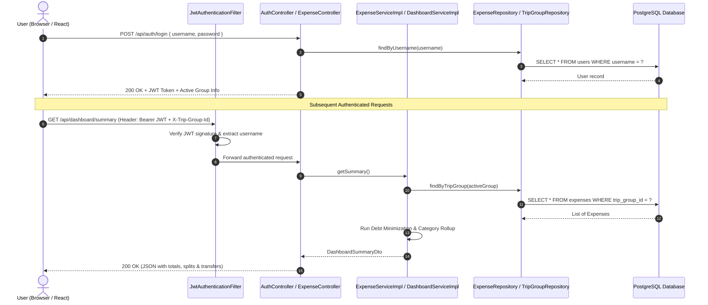

# 📘 Backend Code & Workflow Comprehensive Guide (`Readme_Code_Explanation`)

> **Target Audience:** Beginners with **zero prior knowledge** of Java, Spring Boot, databases, or web architecture.  
> **Goal:** This document explains the **exact workflow**, **system design**, and **every single line of code, annotation, and configuration** in the Trip Expense Tracker backend repository without skipping anything.

---

## 📑 Table of Contents
1. [Fundamental Concepts for Beginners](#1-fundamental-concepts-for-beginners)
   - [What is a Backend?](#what-is-a-backend)
   - [What is Java & JVM?](#what-is-java--jvm)
   - [What is Spring Boot?](#what-is-spring-boot)
   - [What is an Annotation (`@...`)?](#what-is-an-annotation-)
   - [What is MVC / Layered Architecture?](#what-is-mvc--layered-architecture)
   - [What is JPA / Hibernate & ORM?](#what-is-jpa--hibernate--orm)
   - [What is a REST API & HTTP Methods?](#what-is-a-rest-api--http-methods)
   - [What is JWT (JSON Web Token) Security?](#what-is-jwt-json-web-token-security)
2. [End-to-End Workflow & Request Lifecycle](#2-end-to-end-workflow--request-lifecycle)
   - [Architectural Flowchart](#architectural-flowchart)
   - [Step 1: User Registration & Login](#step-1-user-registration--login)
   - [Step 2: Group Creation, Selection & Multi-Tenancy Scoping](#step-2-group-creation-selection--multi-tenancy-scoping)
   - [Step 3: Recording Expenses & Pre-Trip Budgets](#step-3-recording-expenses--pre-trip-budgets)
   - [Step 4: Real-time Settlement Algorithm (Greedy Bilateral Minimization)](#step-4-real-time-settlement-algorithm)
   - [Step 5: Cloud Health Check](#step-5-cloud-health-check)
3. [Configuration & Build Files Explained Line-by-Line](#3-configuration--build-files-explained-line-by-line)
   - [`pom.xml` (Maven Project Object Model)](#pomxml-line-by-line)
   - [`application.properties` (Environment & Database Settings)](#applicationproperties-line-by-line)
4. [Application Bootstrap & Entry Point](#4-application-bootstrap--entry-point)
   - [`TripExpenseTrackerApplication.java`](#tripexpensetrackerapplicationjava-line-by-line)
5. [CORS & Network Security Configuration](#5-cors--network-security-configuration)
   - [`CorsConfig.java`](#corsconfigjava-line-by-line)
6. [Security & Authentication Layer](#6-security--authentication-layer)
   - [`SecurityConfig.java`](#securityconfigjava-line-by-line)
   - [`JwtTokenProvider.java`](#jwttokenproviderjava-line-by-line)
   - [`JwtAuthenticationFilter.java`](#jwtauthenticationfilterjava-line-by-line)
7. [Database Entities (JPA / PostgreSQL Tables)](#7-database-entities-jpa--postgresql-tables)
   - [`User.java`](#userjava-line-by-line)
   - [`TripGroup.java`](#tripgroupjava-line-by-line)
   - [`Expense.java`](#expensejava-line-by-line)
   - [`Category.java`](#categoryjava-line-by-line)
   - [`PaymentMode.java`](#paymentmodejava-line-by-line)
   - [`FundContribution.java`](#fundcontributionjava-line-by-line)
   - [`PreTripMember.java`](#pretripmemberjava-line-by-line)
   - [`PreTripExpense.java`](#pretripexpensejava-line-by-line)
8. [Repositories (Data Access Layer)](#8-repositories-data-access-layer)
   - [`UserRepository.java`](#userrepositoryjava-line-by-line)
   - [`TripGroupRepository.java`](#tripgrouprepositoryjava-line-by-line)
   - [`ExpenseRepository.java`](#expenserepositoryjava-line-by-line)
   - [`FundContributionRepository.java`](#fundcontributionrepositoryjava-line-by-line)
   - [`PreTripMemberRepository.java`](#pretripmemberrepositoryjava-line-by-line)
   - [`PreTripExpenseRepository.java`](#pretripexpenserepositoryjava-line-by-line)
9. [Controllers (REST API Layer)](#9-controllers-rest-api-layer)
   - [`AuthController.java`](#authcontrollerjava-line-by-line)
   - [`ExpenseController.java`](#expensecontrollerjava-line-by-line)
   - [`FundController.java`](#fundcontrollerjava-line-by-line)
   - [`PreTripController.java`](#pretripcontrollerjava-line-by-line)
   - [`DashboardController.java`](#dashboardcontrollerjava-line-by-line)
   - [`HealthController.java`](#healthcontrollerjava-line-by-line)
10. [Service Layer (Business Logic Engine)](#10-service-layer-business-logic-engine)
    - [`ExpenseService.java` & `ExpenseServiceImpl.java`](#expenseservice-and-impl-line-by-line)
    - [`FundService.java` & `FundServiceImpl.java`](#fundservice-and-impl-line-by-line)
    - [`PreTripService.java` & `PreTripServiceImpl.java`](#pretripservice-and-impl-line-by-line)
    - [`DashboardService.java` & `DashboardServiceImpl.java`](#dashboardservice-and-impl-line-by-line)
11. [Data Transfer Objects (DTOs)](#11-data-transfer-objects-dtos)
12. [Global Exception Handling](#12-global-exception-handling)
    - [`GlobalExceptionHandler.java`](#globalexceptionhandlerjava-line-by-line)
13. [Quick Annotation Reference Dictionary](#13-quick-annotation-reference-dictionary)

---

## 1. Fundamental Concepts for Beginners

If you have never coded before or are new to Java and web backends, read this section carefully. Every concept used in this repository builds on these fundamentals:

### What is a Backend?
When you interact with a web application (like clicking "Add Expense" on the React frontend), your browser cannot directly write to a database on the server because that would be insecure. Instead, the browser sends an HTTP request across the internet to the **Backend**.  
The backend:
1. Validates who you are (Authentication).
2. Verifies if you have permission to perform the action (Authorization).
3. Executes mathematical calculations (like expense splits and balance transfers).
4. Reads from and writes to the permanent database (PostgreSQL).
5. Returns a structured JSON response back to your browser.

### What is Java & JVM?
- **Java** is a strongly typed, object-oriented programming language. "Strongly typed" means every variable must declare what type of data it holds (e.g., `String` for text, `Long` for whole numbers, `BigDecimal` for currency).
- **JVM (Java Virtual Machine)**: When Java code compiles, it becomes bytecode (`.class` files). The JVM runs this bytecode on any operating system (Windows, Linux, macOS, Docker containers) identically.

### What is Spring Boot?
Building a web server from scratch in raw Java requires hundreds of lines of socket programming and HTTP parsing.  
**Spring Boot** is a world-class framework that automatically configures:
- An embedded web server (Apache Tomcat) listening on a port (e.g., 8080).
- Automatic object instantiation and wiring (Dependency Injection / Inversion of Control).
- Database connection pools.
- Security filters and JSON serialization/deserialization.

### What is an Annotation (`@...`)?
In Java, words starting with an `@` symbol (like `@Service`, `@Entity`, `@PostMapping`) are **Annotations**.  
Annotations are metadata tags that instruct the Java compiler and the Spring framework to inject behavior automatically without requiring boilerplate code:
- Example: Instead of writing 50 lines of code to create an HTTP route, writing `@GetMapping("/health")` tells Spring: *"Whenever an HTTP GET arrives at `/health`, run this function."*

### What is MVC / Layered Architecture?
This project is organized into strict, decoupled layers:
1. **Controller Layer (`controller/`)**: The front door. Listens for incoming HTTP web requests, validates input formats, and delegates work to services.
2. **Service Layer (`service/`)**: The brain. Contains business rules, math algorithms (settlement calculator), and permission verification.
3. **Repository Layer (`repository/`)**: The data librarian. Communicates with PostgreSQL using SQL queries.
4. **Entity Layer (`entity/`)**: The blueprint. Java classes mapped 1:1 to database tables.
5. **DTO Layer (`dto/`)**: Data Transfer Objects. Pure data shapes sent between client and server.

```
[ Browser / React App ]
          │  HTTP Request (with JSON & Bearer Token)
          ▼
   [ Security Filter & CORS ]  (Intercepts, validates JWT, checks domain)
          │
          ▼
    [ Controller ]             (Accepts request, checks @Valid)
          │
          ▼
     [ Service ]               (Calculates math, enforces rules)
          │
          ▼
    [ Repository ]             (Spring Data JPA translates to SQL)
          │
          ▼
   [ PostgreSQL DB ]           (Stores tables: users, expenses, etc.)
```

### What is JPA / Hibernate & ORM?
- **ORM (Object-Relational Mapping)**: In Java, data is stored in Objects. In databases, data is stored in Tables (rows and columns). ORM bridges the two.
- **JPA (Jakarta Persistence API)**: The standard Java specification for ORM.
- **Hibernate**: The engine underneath Spring Boot that generates and executes real SQL statements (`SELECT`, `INSERT`, `UPDATE`, `DELETE`) on your behalf based on your Java Entity classes.

### What is a REST API & HTTP Methods?
A **REST API** (Representational State Transfer) allows computers to communicate using standard HTTP verbs:
- **`GET`**: Retrieve data without changing anything (e.g., fetch all expenses).
- **`POST`**: Create a new record (e.g., save a new expense).
- **`PUT`**: Update an existing record completely.
- **`DELETE`**: Remove a record permanently.

### What is JWT (JSON Web Token) Security?
Instead of keeping a session open in server memory (which wastes RAM and does not scale well across multiple servers), this backend uses **stateless JWT tokens**:
1. When you log in with your username and password, the server verifies your credentials.
2. If valid, the server cryptographically signs a string containing your username and expiration date using a private secret key.
3. The server sends this token back to the browser.
4. On all subsequent requests, the browser sends this token in the `Authorization: Bearer <token>` header.
5. The backend validates the signature. If valid, it knows who you are without querying the database each time for credentials!

---

## 2. End-to-End Workflow & Request Lifecycle

### Architectural Flowchart


### Step 1: User Registration & Login
1. **Registration (`POST /api/auth/register`)**:
   - The user submits `username`, `password`, and `email`.
   - The backend checks `userRepository.existsByUsername(username)`. If taken, returns HTTP 400.
   - The password is encrypted with **BCrypt** (a one-way cryptographic hashing algorithm with salt). Raw passwords are never stored in plain text.
   - The user record is saved to the `users` table.
2. **Login (`POST /api/auth/login`)**:
   - The user sends `username` and raw `password`.
   - `passwordEncoder.matches(rawPassword, encodedPassword)` compares hashes.
   - If valid, `JwtTokenProvider` builds a signed token valid for 24 hours.
   - The backend queries `tripGroupRepository.findAssociatedGroups()` to see if this user belongs to any active trip groups.
   - The response includes the token, username, group ID, and whether the user is the trip group creator (admin).

### Step 2: Group Creation, Selection & Multi-Tenancy Scoping
- A user can create a Trip Group (`POST /api/auth/group`) and invite other users by username or email.
- The creator becomes the owner (`creator_id`).
- When invited, other members are stored in `trip_group_members`.
- **Multi-Tenancy Isolation via `X-Trip-Group-Id`**:
  - In a shared application, User A must never see User B's expenses.
  - The frontend passes an HTTP header: `X-Trip-Group-Id: <id>`.
  - The service helper `getActiveTripGroup()` inspects this header, verifies that the currently logged-in user is either the creator or an invited member of that group, and strictly scopes all database queries to that `trip_group_id`.
  - If a member attempts to edit or delete expenses, `verifyWriteAccess()` blocks the request with HTTP 403 Forbidden because **only the group creator has admin edit privileges**.

### Step 3: Recording Expenses & Pre-Trip Budgets
Expenses exist in two distinct phases:
1. **Pre-Trip Planning (`/api/pretrip/*`)**:
   - Members register target budget limits (defaulting to ₹10,000.00).
   - Advance purchases (flights, hotels, bookings) are logged under `pre_trip_expenses`.
2. **Active Trip Outflows (`/api/expenses/*`)**:
   - Real-time expenses incurred during the trip (food, fuel, drinks, entry fees).
   - Categorized under `Category` enum (`FOOD`, `TRANSPORT`, `ACCOMMODATION`, etc.).
   - Stored with `PaymentMode` (`CASH`, `UPI`, `CARD`, etc.) and `paidBy` (who paid out of pocket).

### Step 4: Real-time Settlement Algorithm
How does the app know who owes whom, while keeping the number of payments as low as possible?  
Both `PreTripServiceImpl` and `DashboardServiceImpl` implement a **Greedy Bilateral Debt Minimization Algorithm**:

1. **Calculate Total Trip Outflow**:
   $$\text{Total Spent} = \sum \text{PreTripExpenses} + \sum \text{ActiveExpenses (Excluding SETTLEMENT)}$$
2. **Calculate Equal Share Per Member**:
   $$\text{Share Per Member} = \frac{\text{Total Spent}}{\text{Number of Members}}$$
3. **Compute Out-of-Pocket Expenditure Per Member**:
   - If an expense was paid by `"Group"` pool, it is split equally among all members.
   - If paid by an individual (e.g., `"Alice"`), Alice's personal spending tally increases by that amount.
   - When a peer-to-peer settlement payment occurs (`category = SETTLEMENT`, e.g., `"Bob paid Alice ₹500"`):
     - Bob's out-of-pocket tally increases by ₹500 (reducing his debt).
     - Alice's tally decreases by ₹500 (marking her credit as received).
4. **Determine Net Balances**:
   $$\text{Net Balance} = \text{Total Spent by Member} - \text{Share Per Member}$$
   - **Positive balance ($> 0$)**: The member paid more than their fair share. They are a **Creditor** (money is owed to them).
   - **Negative balance ($< 0$)**: The member paid less than their fair share. They are a **Debtor** (they owe money).
5. **Greedy Matching**:
   - All Creditors are sorted in descending order of surplus balance.
   - All Debtors are sorted in descending order of debt magnitude.
   - Two pointers step through both lists: the biggest debtor pays as much as possible to the biggest creditor:
     $$\text{Transfer Amount} = \min(\text{Creditor Surplus}, \text{Debtor Debt})$$
   - Once a debtor reaches 0 balance, we move to the next debtor. Once a creditor reaches 0 surplus, we move to the next creditor.
   - Result: Minimal transactions needed to balance the group completely to zero!

### Step 5: Cloud Health Check
Cloud platforms (like Render, Railway, AWS ECS) ping web applications periodically to determine if the container is healthy or should be rebooted.  
If health checks execute database queries (`SELECT 1`), database spikes can cause false container restarts.  
The backend provides a dedicated, lightweight `/health` endpoint that returns HTTP 200 `"OK"` in sub-millisecond time without touching the database.

---

## 3. Configuration & Build Files Explained Line-by-Line

### `pom.xml` Line-by-Line
`pom.xml` (Project Object Model) is the configuration file for **Maven**, Java's build tool and dependency manager. It downloads required third-party libraries from Maven Central and packages your code into an executable `.jar` file.

```xml
1: <?xml version="1.0" encoding="UTF-8"?>
```
- Line 1: Standard XML declaration indicating version 1.0 and UTF-8 text encoding.

```xml
2: <project xmlns="http://maven.apache.org/POM/4.0.0" ...>
3:   xsi:schemaLocation="http://maven.apache.org/POM/4.0.0 https://maven.apache.org/xsd/maven-4.0.0.xsd">
4:   <modelVersion>4.0.0</modelVersion>
```
- Lines 2–4: Defines the XML namespaces and specifies that this POM conforms to Maven Model Version 4.0.0.

```xml
5:   <parent>
6:     <groupId>org.springframework.boot</groupId>
7:     <artifactId>spring-boot-starter-parent</artifactId>
8:     <version>3.2.5</version>
9:     <relativePath/>
10:  </parent>
```
- Lines 5–10: Declares **Spring Boot Starter Parent** version 3.2.5. This parent configuration provides default compiler settings, resource filtering, and dependency version management so you don't have to specify version numbers for standard Spring libraries.

```xml
11:  <groupId>com.tripexpense</groupId>
12:  <artifactId>tracker</artifactId>
13:  <version>0.0.1-SNAPSHOT</version>
14:  <name>Trip Expense Tracker</name>
15:  <description>Simple CRUD backend for managing trip purchases and cash outflow</description>
```
- Line 11: `groupId`: Unique package identity for your organization (`com.tripexpense`).
- Line 12: `artifactId`: The unique name of this project artifact (`tracker`).
- Line 13: `version`: Current development iteration (`0.0.1-SNAPSHOT`).
- Lines 14–15: Human-readable project name and description.

```xml
17:  <properties>
18:    <java.version>17</java.version>
19:  </properties>
```
- Lines 17–19: Instructs Maven to compile source code using **Java 17 (LTS)** standard syntax and bytecode compatibility.

```xml
21:  <dependencies>
22:    <!-- Spring Boot Web -->
23:    <dependency>
24:      <groupId>org.springframework.boot</groupId>
25:      <artifactId>spring-boot-starter-web</artifactId>
26:    </dependency>
```
- Lines 22–26: `spring-boot-starter-web`: Pulls in Apache Tomcat (embedded HTTP web server), Spring MVC (for `@RestController`, `@GetMapping`, etc.), and Jackson (for converting Java objects to JSON).

```xml
28:    <!-- Spring Data JPA -->
29:    <dependency>
30:      <groupId>org.springframework.boot</groupId>
31:      <artifactId>spring-boot-starter-data-jpa</artifactId>
32:    </dependency>
```
- Lines 28–32: `spring-boot-starter-data-jpa`: Pulls in Hibernate ORM, HikariCP (high-performance database connection pool), and Spring Data repository abstractions.

```xml
34:    <!-- Bean Validation -->
35:    <dependency>
36:      <groupId>org.springframework.boot</groupId>
37:      <artifactId>spring-boot-starter-validation</artifactId>
38:    </dependency>
```
- Lines 34–38: `spring-boot-starter-validation`: Pulls in Hibernate Validator to enforce constraints like `@NotBlank`, `@NotNull`, and `@Positive` on incoming JSON request bodies.

```xml
40:    <!-- PostgreSQL Driver -->
41:    <dependency>
42:      <groupId>org.postgresql</groupId>
43:      <artifactId>postgresql</artifactId>
44:      <scope>runtime</scope>
45:    </dependency>
```
- Lines 40–45: `postgresql`: The official JDBC driver enabling Java to communicate over the network with PostgreSQL relational databases.

```xml
47:    <!-- Lombok -->
48:    <dependency>
49:      <groupId>org.projectlombok</groupId>
50:      <artifactId>lombok</artifactId>
51:      <optional>true</optional>
52:    </dependency>
```
- Lines 47–52: `lombok`: A compiler annotation processor that automatically generates getters, setters, constructors, and builder patterns during build time, keeping your Java files clean.

```xml
54:    <!-- Spring Boot Test -->
55:    <dependency>
56:      <groupId>org.springframework.boot</groupId>
57:      <artifactId>spring-boot-starter-test</artifactId>
58:      <scope>test</scope>
59:    </dependency>
```
- Lines 54–59: Test dependencies including JUnit 5, AssertJ, and Mockito for unit and integration testing.

```xml
61:    <!-- Spring Security -->
62:    <dependency>
63:      <groupId>org.springframework.boot</groupId>
64:      <artifactId>spring-boot-starter-security</artifactId>
65:    </dependency>
```
- Lines 61–65: `spring-boot-starter-security`: Spring's security framework for handling authentication, authorization, password hashing, and HTTP request filtering.

```xml
67:    <!-- JJWT for JWT Token support -->
68:    <dependency>
69:      <groupId>io.jsonwebtoken</groupId>
70:      <artifactId>jjwt-api</artifactId>
71:      <version>0.11.5</version>
72:    </dependency>
73:    <dependency>
74:      <groupId>io.jsonwebtoken</groupId>
75:      <artifactId>jjwt-impl</artifactId>
76:      <version>0.11.5</version>
77:      <scope>runtime</scope>
78:    </dependency>
79:    <dependency>
80:      <groupId>io.jsonwebtoken</groupId>
81:      <artifactId>jjwt-jackson</artifactId>
82:      <version>0.11.5</version>
83:      <scope>runtime</scope>
84:    </dependency>
```
- Lines 67–84: **Java JWT (JJWT)** library version 0.11.5. Splits into API interface (`jjwt-api`), runtime implementation (`jjwt-impl`), and JSON serializer (`jjwt-jackson`) to generate, sign, and verify JSON Web Tokens.

```xml
87:  <build>
88:    <plugins>
89:      <plugin>
90:        <groupId>org.springframework.boot</groupId>
91:        <artifactId>spring-boot-maven-plugin</artifactId>
...
98:      </plugin>
99:    </plugins>
100: </build>
```
- Lines 87–102: The Spring Boot Maven Plugin packages your project into an executable "fat JAR" with all dependencies bundled inside, and excludes Lombok from the final production binary since it is only needed during compilation.

---

### `application.properties` Line-by-Line
Located at `src/main/resources/application.properties`, this file defines runtime configuration parameters.

```properties
1: spring.application.name=trip-expense-tracker
```
- Line 1: Gives the application a logical name used in log files and monitoring dashboards.

```properties
2: server.port=${PORT:8080}
```
- Line 2: Tells embedded Tomcat which port to listen on. `${PORT:8080}` uses the environment variable `PORT` if defined (such as on cloud hosts like Render or Heroku); otherwise, it defaults to port `8080`.

```properties
4: spring.datasource.url=${SPRING_DATASOURCE_URL}
5: spring.datasource.username=${SPRING_DATASOURCE_USERNAME}
6: spring.datasource.password=${SPRING_DATASOURCE_PASSWORD}
7: spring.datasource.driver-class-name=org.postgresql.Driver
```
- Lines 4–6: Configures the PostgreSQL connection string, database user, and database password dynamically from environment variables. This prevents hardcoding sensitive credentials into version control.
- Line 7: Specifies `org.postgresql.Driver` as the JDBC driver class.

```properties
9: # JPA / Hibernate Settings
10: spring.jpa.hibernate.ddl-auto=update
```
- Line 10: `ddl-auto=update`: Instructs Hibernate to inspect your `@Entity` Java classes on startup and automatically create or alter tables and columns in PostgreSQL to match your Java code without wiping out existing data.

```properties
11: spring.jpa.show-sql=true
12: spring.jpa.properties.hibernate.format_sql=true
```
- Lines 11–12: Prints all generated SQL statements to the terminal console and formats them with indentation for easy debugging.

```properties
13: spring.jpa.properties.hibernate.dialect=org.hibernate.dialect.PostgreSQLDialect
```
- Line 13: Configures the PostgreSQL SQL dialect so Hibernate uses PostgreSQL-specific SQL syntax (like `BIGSERIAL` identity columns and JSON operators).

---

## 4. Application Bootstrap & Entry Point

### `TripExpenseTrackerApplication.java` Line-by-Line
File: `src/main/java/com/tripexpense/tracker/TripExpenseTrackerApplication.java`

```java
1: package com.tripexpense.tracker;
```
- Line 1: Package declaration defining the root namespace.

```java
3: import org.springframework.boot.SpringApplication;
4: import org.springframework.boot.autoconfigure.SpringBootApplication;
5: import org.springframework.beans.factory.annotation.Autowired;
6: import org.springframework.jdbc.core.JdbcTemplate;
7: import jakarta.annotation.PostConstruct;
```
- Lines 3–7: Imports Spring Boot starter classes, Dependency Injection annotation `@Autowired`, raw SQL helper `JdbcTemplate`, and lifecycle callback `@PostConstruct`.

```java
9: @SpringBootApplication
10: public class TripExpenseTrackerApplication {
```
- Line 9: `@SpringBootApplication`: A composite meta-annotation that bundles:
  1. `@Configuration`: Tags the class as a source of bean definitions.
  2. `@EnableAutoConfiguration`: Tells Spring Boot to automatically configure beans based on classpath dependencies.
  3. `@ComponentScan`: Tells Spring to scan this package and all sub-packages for `@Component`, `@Service`, `@Repository`, and `@RestController` classes.
- Line 10: Public class declaration.

```java
12:   @Autowired
13:   private JdbcTemplate jdbcTemplate;
```
- Lines 12–13: Injects `JdbcTemplate`, Spring's low-level utility for running direct, parameterized SQL commands against the database.

```java
15:   public static void main(String[] args) {
16:     SpringApplication.run(TripExpenseTrackerApplication.class, args);
17:   }
```
- Lines 15–17: The main entry point of the Java program. `SpringApplication.run` launches Tomcat, initializes the ApplicationContext, connects to PostgreSQL, and starts accepting web traffic.

```java
19:   @PostConstruct
20:   public void dropConstraints() {
```
- Lines 19–20: `@PostConstruct` executes this method automatically **once**, immediately after the Spring context initializes and database connections are established.

```java
21:     try {
22:       jdbcTemplate.execute("ALTER TABLE pre_trip_members DROP CONSTRAINT IF EXISTS uk_hhawsncs4us42a2r9h53m5r87");
23:       System.out.println("Successfully dropped unique constraint uk_hhawsncs4us42a2r9h53m5r87 on pre_trip_members name column!");
24:     } catch (Exception e) {
25:       System.err.println("Could not drop pre_trip_members constraint: " + e.getMessage());
26:     }
```
- Lines 21–26: Drops an obsolete database constraint that previously prevented different trip groups from having members with the same name. By removing it, different groups can now have members with identical names (e.g. "Alex") without conflict.

```java
28:     try {
29:       jdbcTemplate.execute("ALTER TABLE expenses DROP CONSTRAINT IF EXISTS expenses_category_check");
30:       System.out.println("Successfully dropped check constraint expenses_category_check on expenses table!");
31:     } catch (Exception e) {
32:       System.err.println("Could not drop expenses check constraint: " + e.getMessage());
33:     }
```
- Lines 28–33: Drops a PostgreSQL check constraint on the `expenses` table category column, allowing new categories (such as `SETTLEMENT`) to be stored without schema validation errors.

```java
35:     // Diagnostics
36:     try {
37:       System.out.println("=== DIAGNOSTICS: USERS ===");
38:       jdbcTemplate.queryForList("SELECT id, username, email FROM users")
39:           .forEach(row -> System.out.println("User: " + row));
...
54:     } catch (Exception e) {
55:       System.err.println("Diagnostics failed: " + e.getMessage());
56:     }
57:   }
58: }
```
- Lines 35–57: Diagnostic logs printed on startup displaying registered users, active trip groups, group memberships, and recorded settlement transactions to verify database state upon deployment.

---

## 5. CORS & Network Security Configuration

### `CorsConfig.java` Line-by-Line
File: `src/main/java/com/tripexpense/tracker/config/CorsConfig.java`

**What is CORS?**  
Cross-Origin Resource Sharing is a browser security mechanism that blocks websites on domain A (e.g., `https://tour-expence-tracker-frontend.vercel.app`) from making requests to domain B (e.g., `https://api.yourdomain.com`) unless domain B explicitly approves it.

```java
1: package com.tripexpense.tracker.config;
...
11: @Configuration
12: public class CorsConfig {
```
- Line 11: `@Configuration`: Marks this class as a configuration provider to instantiate Spring beans.

```java
14:   @Bean
15:   public CorsFilter corsFilter() {
16:     CorsConfiguration config = new CorsConfiguration();
```
- Lines 14–16: `@Bean` registers the returned `CorsFilter` into the Spring ApplicationContext.

```java
19:     config.setAllowedOriginPatterns(Arrays.asList(
20:         "http://localhost:3000",
21:         "http://localhost:3001",
22:         "http://localhost:5173",
23:         "http://localhost:8080",
24:         "https://*.onrender.com",
25:         "https://*.netlify.app",
26:         "https://*.vercel.app",
27:         "https://tour-expence-tracker-frontend.vercel.app"
28:     ));
```
- Lines 19–28: `setAllowedOriginPatterns`: Whitelists trusted frontend client URLs:
  - Local Vite dev servers (`localhost:5173`) and React servers (`localhost:3000`, `3001`).
  - Production deployments on Render, Netlify, and the official live Vercel URL.

```java
30:     config.setAllowedHeaders(Arrays.asList(
31:         "Origin", "Access-Control-Allow-Origin", "Content-Type", "Accept", 
35:         "Authorization", "Origin, Accept", "X-Requested-With", 
38:         "Access-Control-Request-Method", "Access-Control-Request-Headers",
40:         "X-Trip-Group-Id", "x-trip-group-id"
42:     ));
```
- Lines 30–42: Allows standard HTTP headers plus custom headers:
  - `Authorization`: Required for sending JWT tokens.
  - `X-Trip-Group-Id`: Required for scoping data to the selected trip group.

```java
44:     config.setExposedHeaders(Arrays.asList(
45:         "Origin", "Content-Type", "Accept", "Authorization", 
49:         "Access-Control-Allow-Origin", "Access-Control-Allow-Credentials"
51:     ));
```
- Lines 44–51: Exposes response headers so the frontend JavaScript can inspect them.

```java
53:     config.setAllowedMethods(Arrays.asList("GET", "POST", "PUT", "DELETE", "OPTIONS", "PATCH"));
62:     config.setAllowCredentials(true);
```
- Line 53: Allows all required REST methods plus `OPTIONS` (used by browsers for pre-flight CORS checks).
- Line 62: Allows cookies, authorization headers, and SSL client certificates.

```java
64:     UrlBasedCorsConfigurationSource source = new UrlBasedCorsConfigurationSource();
65:     source.registerCorsConfiguration("/**", config);
66:     return new CorsFilter(source);
67:   }
68: }
```
- Lines 64–67: Applies this CORS policy globally across every single route (`/**`) in the application.

---

## 6. Security & Authentication Layer

### `SecurityConfig.java` Line-by-Line
File: `src/main/java/com/tripexpense/tracker/security/SecurityConfig.java`

```java
16: @Configuration
17: @EnableWebSecurity
18: @RequiredArgsConstructor
19: public class SecurityConfig {
20: 
21:   private final JwtAuthenticationFilter jwtAuthenticationFilter;
```
- Line 17: `@EnableWebSecurity`: Activates Spring Security's web protection system.
- Line 18: `@RequiredArgsConstructor` (Lombok): Generates a constructor that automatically injects the `JwtAuthenticationFilter`.

```java
23:   @Bean
24:   public SecurityFilterChain securityFilterChain(HttpSecurity http) throws Exception {
25:     http
26:       .csrf(csrf -> csrf.disable())
```
- Line 26: Disables CSRF (Cross-Site Request Forgery) protection. CSRF tokens are only needed for cookie-based session architectures; stateless JWT APIs do not use session cookies and are immune to classic CSRF.

```java
27:       .sessionManagement(session -> session.sessionCreationPolicy(SessionCreationPolicy.STATELESS))
```
- Line 27: Enforces **stateless sessions**. The server will never create an `HttpSession` or store state in RAM between requests.

```java
28:       .authorizeHttpRequests(auth -> auth
29:         .requestMatchers("/api/auth/register", "/api/auth/login", "/health").permitAll()
30:         .requestMatchers("/error").permitAll()
31:         .anyRequest().authenticated()
32:       );
```
- Lines 28–32: Defines route access permissions:
  - `/api/auth/register`, `/api/auth/login`, and `/health` are **public (`permitAll()`)**.
  - All other routes require a valid authenticated JWT token (`authenticated()`).

```java
34:     http.addFilterBefore(jwtAuthenticationFilter, UsernamePasswordAuthenticationFilter.class);
36:     return http.build();
37:   }
```
- Line 34: Injects our custom `JwtAuthenticationFilter` ahead of Spring's default username-password filter so that tokens are checked on every incoming request.

```java
39:   @Bean
40:   public PasswordEncoder passwordEncoder() {
41:     return new BCryptPasswordEncoder();
42:   }
```
- Lines 39–42: Exposes `BCryptPasswordEncoder` as a Spring Bean so passwords can be hashed and verified across the application.

```java
44:   @Bean
45:   public AuthenticationManager authenticationManager(AuthenticationConfiguration configuration) throws Exception {
46:     return configuration.getAuthenticationManager();
47:   }
```
- Lines 44–47: Exposes Spring's central `AuthenticationManager` bean.

---

### `JwtTokenProvider.java` Line-by-Line
File: `src/main/java/com/tripexpense/tracker/security/JwtTokenProvider.java`

Handles cryptographic generation, decoding, and validation of JSON Web Tokens.

```java
15: @Component
16: public class JwtTokenProvider {
17: 
18:   // Base64 encoded key (256-bit minimum)
19:   private static final String SECRET_KEY = "YW50aWdyYXZpdHktY29kaW5nLWFzc2lzdGFudC1zZWN1cmUta2V5LTI1Ni1iaXRzLW1pbmltdW0=";
20:   private static final long EXPIRATION_TIME = 86400000; // 24 hours in ms
```
- Line 15: `@Component`: Marks this as a managed Spring component available for dependency injection.
- Line 19: `SECRET_KEY`: A Base64-encoded 256-bit secret key used by HMAC-SHA256 to sign and verify tokens.
- Line 20: `EXPIRATION_TIME`: 86,400,000 milliseconds = 24 hours.

```java
24:   public JwtTokenProvider() {
25:     this.key = Keys.hmacShaKeyFor(Decoders.BASE64.decode(SECRET_KEY));
26:   }
```
- Lines 24–26: Constructor that decodes the Base64 secret key into a secure cryptographic `Key` object on startup.

```java
28:   public String generateToken(String username) {
29:     Map<String, Object> claims = new HashMap<>();
30:     return createToken(claims, username);
31:   }
```
- Lines 28–31: Generates a new token for a given username.

```java
33:   private String createToken(Map<String, Object> claims, String subject) {
34:     return Jwts.builder()
35:         .setClaims(claims)
36:         .setSubject(subject)
37:         .setIssuedAt(new Date(System.currentTimeMillis()))
38:         .setExpiration(new Date(System.currentTimeMillis() + EXPIRATION_TIME))
39:         .signWith(key, SignatureAlgorithm.HS256)
40:         .compact();
41:   }
```
- Lines 33–41: Builds the token using JJWT:
  - `setSubject(subject)`: Sets the owner's username.
  - `setIssuedAt`: Current timestamp.
  - `setExpiration`: Current timestamp + 24 hours.
  - `signWith(key, HS256)`: Cryptographically signs the payload with HMAC-SHA256.
  - `compact()`: Converts to the final compact three-part string (`header.payload.signature`).

```java
43:   public boolean validateToken(String token, UserDetails userDetails) {
44:     final String username = extractUsername(token);
45:     return (username.equals(userDetails.getUsername()) && !isTokenExpired(token));
46:   }
```
- Lines 43–46: Validates that the token's username matches the database user and that the expiration timestamp has not passed.

```java
48:   public String extractUsername(String token) {
49:     return extractClaim(token, Claims::getSubject);
50:   }
```
- Lines 48–50: Extracts the subject (username) from the token payload.

```java
61:   private Claims extractAllClaims(String token) {
62:     return Jwts.parserBuilder()
63:         .setSigningKey(key)
64:         .build()
65:         .parseClaimsJws(token)
66:         .getBody();
67:   }
```
- Lines 61–67: Parses and verifies the cryptographic signature against the secret key. If the token was tampered with, an exception is thrown.

```java
69:   private boolean isTokenExpired(String token) {
70:     return extractExpiration(token).before(new Date());
71:   }
```
- Lines 69–71: Returns true if the token's expiration date is in the past.

---

### `JwtAuthenticationFilter.java` Line-by-Line
File: `src/main/java/com/tripexpense/tracker/security/JwtAuthenticationFilter.java`

Executes once on every incoming HTTP request to authenticate the user before it reaches any Controller.

```java
20: @Component
21: @RequiredArgsConstructor
22: public class JwtAuthenticationFilter extends OncePerRequestFilter {
23: 
24:   private final JwtTokenProvider jwtTokenProvider;
25:   private final UserRepository userRepository;
```
- Line 22: `extends OncePerRequestFilter`: Guarantees this filter will run exactly once per request.

```java
28:   protected void doFilterInternal(HttpServletRequest request, HttpServletResponse response, FilterChain filterChain)
29:       throws ServletException, IOException {
30: 
31:     final String authHeader = request.getHeader("Authorization");
32:     final String jwt;
33:     final String username;
34: 
35:     if (authHeader == null || !authHeader.startsWith("Bearer ")) {
36:       filterChain.doFilter(request, response);
37:       return;
38:     }
```
- Lines 28–38: Checks if the request contains an `Authorization` header beginning with `"Bearer "`. If absent (e.g. for `/health` or `/api/auth/login`), it immediately passes the request along the chain.

```java
40:     jwt = authHeader.substring(7);
41:     try {
42:       username = jwtTokenProvider.extractUsername(jwt);
43:     } catch (Exception e) {
44:       filterChain.doFilter(request, response);
45:       return;
46:     }
```
- Lines 40–46: Strips off the `"Bearer "` prefix (first 7 characters) to get the raw token and extracts the username.

```java
48:     if (username != null && SecurityContextHolder.getContext().getAuthentication() == null) {
49:       var userOpt = userRepository.findByUsername(username);
50:       if (userOpt.isPresent()) {
51:         var user = userOpt.get();
52:         UserDetails userDetails = new User(user.getUsername(), user.getPassword(), new ArrayList<>());
53:         if (jwtTokenProvider.validateToken(jwt, userDetails)) {
54:           UsernamePasswordAuthenticationToken authToken = new UsernamePasswordAuthenticationToken(
55:               userDetails, null, userDetails.getAuthorities()
56:           );
57:           authToken.setDetails(new WebAuthenticationDetailsSource().buildDetails(request));
58:           SecurityContextHolder.getContext().setAuthentication(authToken);
59:         }
60:       }
61:     }
62:     filterChain.doFilter(request, response);
63:   }
```
- Lines 48–63: If the user is found in the database and the token is valid, creates a `UsernamePasswordAuthenticationToken` and sets it in Spring's `SecurityContextHolder`.  
Now the entire application knows who is making this request for the remainder of the thread!

---

## 7. Database Entities (JPA / PostgreSQL Tables)

### `User.java` Line-by-Line
File: `src/main/java/com/tripexpense/tracker/entity/User.java`

Maps to the PostgreSQL `users` table.

```java
6: @Entity
7: @Table(name = "users")
8: @Data
9: @NoArgsConstructor
10: @AllArgsConstructor
11: @Builder
12: public class User {
```
- Line 6: `@Entity`: Tells Hibernate this class represents a database table.
- Line 7: `@Table(name = "users")`: Explicitly names the table `users` (avoiding the reserved SQL keyword `user`).
- Line 8: `@Data` (Lombok): Generates getters, setters, `toString()`, `equals()`, and `hashCode()`.
- Lines 9–10: Generates no-argument and all-argument constructors.
- Line 11: `@Builder`: Enables the Builder design pattern (`User.builder().username(...).build()`).

```java
14:   @Id
15:   @GeneratedValue(strategy = GenerationType.IDENTITY)
16:   private Long id;
```
- Lines 14–16: `@Id` marks this as the Primary Key. `GenerationType.IDENTITY` maps to PostgreSQL's auto-incrementing `BIGSERIAL`.

```java
18:   @Column(unique = true, nullable = false)
19:   private String username;
21:   @Column(nullable = false)
22:   private String password;
24:   @Column(nullable = false)
25:   private String email;
```
- Lines 18–25: Column definitions. `username` is marked unique and not-null. `password` stores the BCrypt hash. `email` stores the contact email.

---

### `TripGroup.java` Line-by-Line
File: `src/main/java/com/tripexpense/tracker/entity/TripGroup.java`

Maps to the `trip_groups` table.

```java
20:   @Column(nullable = false)
21:   private String name;
```
- Name of the trip group (e.g. `"Goa Vacation 2026"`).

```java
23:   @ManyToOne(optional = false)
24:   @JoinColumn(name = "creator_id")
25:   private User creator;
```
- Lines 23–25: Foreign key relationship to the `users` table. Many groups can be created by one user. The creator is the group administrator.

```java
27:   @ElementCollection(fetch = FetchType.EAGER)
28:   @CollectionTable(name = "trip_group_members", joinColumns = @JoinColumn(name = "group_id"))
29:   @Column(name = "username")
30:   private List<String> memberUsernames;
```
- Lines 27–30: `@ElementCollection` creates a secondary table named `trip_group_members` that stores the list of invited usernames linked by `group_id`. `FetchType.EAGER` ensures members are loaded immediately whenever a group is retrieved.

```java
32:   @Column(name = "created_at", nullable = false)
33:   @Builder.Default
34:   private LocalDateTime createdAt = LocalDateTime.now();
```
- Lines 32–34: Creation timestamp defaulting to the current date and time.

---

### `Expense.java` Line-by-Line
File: `src/main/java/com/tripexpense/tracker/entity/Expense.java`

Maps to the `expenses` table for active trip purchases.

```java
25:   @Column(nullable = false)
26:   private String title;
```
- Line 26: Description of the purchase (e.g., `"Seafood Dinner"`).

```java
28:   @Column(nullable = false, precision = 10, scale = 2)
29:   private BigDecimal amount;
```
- Lines 28–29: Money amount. **Never use `double` or `float` for currency** because binary floating-point representation causes rounding inaccuracies (e.g., $0.1 + 0.2 = 0.30000000000000004$). `BigDecimal` with precision 10 and scale 2 ensures exact two-decimal currency calculations up to ₹99,999,999.99.

```java
31:   @Enumerated(EnumType.STRING)
32:   @Column(nullable = false)
33:   private Category category;
```
- Lines 31–33: `@Enumerated(EnumType.STRING)` stores the enum as a human-readable text string (`"FOOD"`, `"TRANSPORT"`) in PostgreSQL rather than an integer index (0, 1), ensuring database readability.

```java
35:   @Enumerated(EnumType.STRING)
36:   @Column(nullable = false)
37:   private PaymentMode paymentMode;
```
- Stored as text: `"CASH"`, `"UPI"`, `"CARD"`, or `"OTHER"`.

```java
39:   @Column(name = "paid_by")
40:   private String paidBy;
42:   @Column(name = "expense_date", nullable = false)
43:   private LocalDate expenseDate;
45:   private String notes;
```
- Line 40: Username of whoever paid out of pocket (or `"Group"` for pooled funds).
- Line 43: Date of the expense (`YYYY-MM-DD`).
- Line 45: Optional additional details.

```java
47:   @ManyToOne(fetch = FetchType.LAZY)
48:   @JoinColumn(name = "trip_group_id")
49:   private TripGroup tripGroup;
```
- Lines 47–49: Foreign key linking this expense to its parent `TripGroup`. `FetchType.LAZY` prevents loading the full group entity until explicitly requested, saving database bandwidth.

```java
54:   @PrePersist
55:   protected void onCreate() {
56:     if (this.createdAt == null) this.createdAt = LocalDateTime.now();
57:     if (this.expenseDate == null) this.expenseDate = LocalDate.now();
58:   }
```
- Lines 54–58: `@PrePersist`: Callback hook executed right before Hibernate inserts a new row. Automatically defaults `createdAt` and `expenseDate` to current timestamps if left blank.

---

### `Category.java` Line-by-Line
File: `src/main/java/com/tripexpense/tracker/entity/Category.java`

```java
3: public enum Category {
4:   FOOD,
5:   DRINKS,
6:   TRANSPORT,
7:   ACCOMMODATION,
8:   SHOPPING,
9:   ENTERTAINMENT,
10:  MISC,
11:  SETTLEMENT
12: }
```
- Lines 3–12: Fixed set of expense categories. Notice `SETTLEMENT`: used specifically when a member pays back another member to balance the books.

---

### `PaymentMode.java` Line-by-Line
File: `src/main/java/com/tripexpense/tracker/entity/PaymentMode.java`

```java
3: public enum PaymentMode {
4:   CASH,
5:   UPI,
6:   CARD,
7:   OTHER
8: }
```
- Lines 3–8: Payment instruments supported across transactions.

---

### `FundContribution.java` Line-by-Line
File: `src/main/java/com/tripexpense/tracker/entity/FundContribution.java`

Maps to the `fund_contributions` table. Tracks money deposited into a communal cash kitty.

```java
25:   @Column(name = "contributor_name", nullable = false)
26:   private String contributorName;
28:   @Column(nullable = false, precision = 10, scale = 2)
29:   private BigDecimal amount;
31:   @Enumerated(EnumType.STRING)
32:   @Column(name = "payment_mode", nullable = false)
33:   private PaymentMode paymentMode;
35:   @Column(name = "contribution_date", nullable = false)
36:   private LocalDate contributionDate;
40:   @ManyToOne(fetch = FetchType.LAZY)
41:   @JoinColumn(name = "trip_group_id")
42:   private TripGroup tripGroup;
```
- Records contributor name, amount contributed, payment method, date, and associated trip group.

---

### `PreTripMember.java` Line-by-Line
File: `src/main/java/com/tripexpense/tracker/entity/PreTripMember.java`

Maps to the `pre_trip_members` table. Represents a member's pre-trip planning persona and budget allocation.

```java
22:   @Column(nullable = false)
23:   private String name;
25:   @Column(nullable = false, precision = 10, scale = 2)
26:   @Builder.Default
27:   private BigDecimal budgetLimit = new BigDecimal("10000.00");
```
- Lines 22–27: Member's name and their target budget limit (defaults to ₹10,000.00).

---

### `PreTripExpense.java` Line-by-Line
File: `src/main/java/com/tripexpense/tracker/entity/PreTripExpense.java`

Maps to the `pre_trip_expenses` table. Stores advance purchases made before the trip commences (e.g. flight tickets, train reservations, Airbnb deposits).

```java
24:   private String title;
26:   private BigDecimal amount;
29:   @Column(name = "spent_by", nullable = false)
30:   private String spentBy;
32:   @Column(name = "expense_date", nullable = false)
33:   private LocalDate expenseDate;
35:   private String notes;
37:   @ManyToOne(fetch = FetchType.LAZY)
38:   @JoinColumn(name = "trip_group_id")
39:   private TripGroup tripGroup;
```
- Tracks who paid in advance (`spentBy`), the title, amount, date, and group reference.

---

## 8. Repositories (Data Access Layer)

Spring Data JPA generates real SQL queries automatically based on method names.

### `UserRepository.java` Line-by-Line
```java
9: @Repository
10: public interface UserRepository extends JpaRepository<User, Long> {
11:   Optional<User> findByUsername(String username);
12:   Optional<User> findByEmail(String email);
13:   Optional<User> findByUsernameOrEmail(String username, String email);
14:   Optional<User> findFirstByUsernameIgnoreCaseOrEmailIgnoreCase(String username, String email);
15:   boolean existsByUsername(String username);
16: }
```
- Line 10: `extends JpaRepository<User, Long>` provides built-in CRUD operations (`save`, `findById`, `findAll`, `deleteById`).
- Line 11: `findByUsername`: Generates `SELECT * FROM users WHERE username = ?`.
- Line 14: `findFirstByUsernameIgnoreCaseOrEmailIgnoreCase`: Finds an account matching either a username or an email address while ignoring uppercase/lowercase differences.
- Line 15: `existsByUsername`: Generates `SELECT count(*) > 0 FROM users WHERE username = ?`.

---

### `TripGroupRepository.java` Line-by-Line
```java
12: @Repository
13: public interface TripGroupRepository extends JpaRepository<TripGroup, Long> {
14:   List<TripGroup> findByCreator(User creator);
15:   
16:   @Query("SELECT tg FROM TripGroup tg WHERE LOWER(tg.creator.username) = LOWER(:username) OR LOWER(:username) IN (SELECT LOWER(m) FROM tg.memberUsernames m) OR LOWER(:email) IN (SELECT LOWER(m) FROM tg.memberUsernames m)")
17:   List<TripGroup> findAssociatedGroups(@Param("username") String username, @Param("email") String email);
18: }
```
- Line 14: Finds all groups created by a specific user.
- Lines 16–17: Custom **JPQL (Java Persistence Query Language)** query that retrieves every trip group where the user is either the creator OR listed in the group's invited members list by username or email.

---

### `ExpenseRepository.java` Line-by-Line
```java
15: @Repository
16: public interface ExpenseRepository extends JpaRepository<Expense, Long> {
18:   List<Expense> findByTripGroup(TripGroup tripGroup);
20:   List<Expense> findByCategoryAndTripGroup(Category category, TripGroup tripGroup);
22:   List<Expense> findByExpenseDateAndTripGroup(LocalDate expenseDate, TripGroup tripGroup);
24:   List<Expense> findByExpenseDateBetweenAndTripGroup(LocalDate startDate, LocalDate endDate, TripGroup tripGroup);
26:   @Query("SELECT SUM(e.amount) FROM Expense e WHERE e.tripGroup = :tripGroup")
27:   BigDecimal getTotalExpensesSum(@Param("tripGroup") TripGroup tripGroup);
29:   @Query("SELECT e.category, SUM(e.amount) FROM Expense e WHERE e.tripGroup = :tripGroup GROUP BY e.category")
30:   List<Object[]> getCategoryExpenseBreakdown(@Param("tripGroup") TripGroup tripGroup);
31: }
```
- Lines 18–24: Scoped queries that filter expenses by trip group, category, exact date, or date ranges.
- Lines 26–27: Aggregates total spending for a group using the SQL `SUM()` function.
- Lines 29–30: Groups expenses by category and sums each group, returning tuples of `[Category, BigDecimal]` to render pie/donut charts on the frontend.

---

### `FundContributionRepository.java` Line-by-Line
```java
16:   List<FundContribution> findByTripGroup(TripGroup tripGroup);
18:   @Query("SELECT SUM(f.amount) FROM FundContribution f WHERE f.tripGroup = :tripGroup")
19:   BigDecimal getTotalFundsSum(@Param("tripGroup") TripGroup tripGroup);
```
- Fetches all contributions for a group and calculates total funds collected.

---

### `PreTripMemberRepository.java` Line-by-Line
```java
13:   List<PreTripMember> findByTripGroup(TripGroup tripGroup);
14:   Optional<PreTripMember> findByNameIgnoreCaseAndTripGroup(String name, TripGroup tripGroup);
15:   boolean existsByNameIgnoreCaseAndTripGroup(String name, TripGroup tripGroup);
```
- Queries members belonging to a trip group and supports case-insensitive name matching.

---

### `PreTripExpenseRepository.java` Line-by-Line
```java
12:   List<PreTripExpense> findByTripGroup(TripGroup tripGroup);
13:   List<PreTripExpense> findBySpentByIgnoreCaseAndTripGroup(String spentBy, TripGroup tripGroup);
```
- Queries pre-trip expenses scoped to a trip group or by individual spender.

---

## 9. Controllers (REST API Layer)

### `AuthController.java` Line-by-Line
File: `src/main/java/com/tripexpense/tracker/controller/AuthController.java`

```java
28: @RestController
29: @RequestMapping("/api/auth")
30: @RequiredArgsConstructor
31: public class AuthController {
```
- Line 28: `@RestController`: Marks this class as an HTTP API controller where methods return JSON directly into the HTTP response body.
- Line 29: `@RequestMapping("/api/auth")`: Base URL path prefix for all endpoints in this controller.

```java
40:   @PostMapping("/register")
41:   public ResponseEntity<String> register(@RequestBody RegisterRequest request) {
42:     if (userRepository.existsByUsername(request.getUsername())) {
43:       return ResponseEntity.badRequest().body("Username already exists!");
44:     }
46:     User user = User.builder()
47:         .username(request.getUsername().trim())
48:         .password(passwordEncoder.encode(request.getPassword()))
49:         .email(request.getEmail().trim())
50:         .build();
52:     userRepository.save(user);
53:     return ResponseEntity.ok("User registered successfully!");
54:   }
```
- Lines 40–54: Validates username uniqueness, hashes the password via BCrypt, saves the user to PostgreSQL, and returns HTTP 200 OK.

```java
56:   @PostMapping("/login")
57:   public ResponseEntity<?> login(@RequestBody AuthRequest request) {
58:     Optional<User> userOpt = userRepository.findByUsername(request.getUsername().trim());
59:     if (userOpt.isEmpty() || !passwordEncoder.matches(request.getPassword(), userOpt.get().getPassword())) {
60:       return ResponseEntity.status(HttpStatus.UNAUTHORIZED).body("Invalid username or password!");
61:     }
63:     User user = userOpt.get();
64:     String token = jwtTokenProvider.generateToken(user.getUsername());
```
- Lines 56–64: Authenticates credentials. If invalid, returns HTTP 401 Unauthorized. If valid, generates a signed JWT token.

```java
67:     List<TripGroup> groups = tripGroupRepository.findAssociatedGroups(user.getUsername(), user.getEmail());
...
73:     if (!groups.isEmpty()) {
74:       TripGroup activeGroup = groups.get(0);
75:       builder.hasGroup(true)
76:           .groupId(activeGroup.getId())
77:           .groupName(activeGroup.getName())
78:           .isCreator(activeGroup.getCreator().getUsername().equalsIgnoreCase(user.getUsername()));
79:     } else {
80:       builder.hasGroup(false);
81:     }
83:     return ResponseEntity.ok(builder.build());
84:   }
```
- Lines 67–84: Locates the user's active groups and returns the JWT token along with group details and admin permissions.

```java
86:   @GetMapping("/member-exists")
87:   public ResponseEntity<Map<String, Boolean>> memberExists(@RequestParam String identifier) {
88:     String normalizedIdentifier = identifier.trim();
89:     boolean exists = !normalizedIdentifier.isEmpty()
90:         && userRepository.findFirstByUsernameIgnoreCaseOrEmailIgnoreCase(
91:             normalizedIdentifier, normalizedIdentifier).isPresent();
93:     return ResponseEntity.ok(Map.of("exists", exists));
94:   }
```
- Lines 86–94: Real-time validation endpoint called by the frontend while typing member names to confirm whether an account exists.

```java
96:   @PostMapping("/group")
97:   public ResponseEntity<?> createGroup(@RequestBody GroupRequest request) {
```
- Lines 96–164: Creates a new Trip Group:
  1. Identifies the creator from `SecurityContextHolder`.
  2. Resolves invited member identifiers against existing registered users.
  3. Saves the `TripGroup` record.
  4. Automatically initializes `PreTripMember` budget profiles for both the creator and all invited members with default ₹10,000 limits.

```java
166:  @GetMapping("/groups")
167:  public ResponseEntity<?> getMyGroups() {
```
- Lines 166–188: Returns all trip groups associated with the currently authenticated user.

```java
190:  @DeleteMapping("/group/{id}")
191:  @Transactional
192:  public ResponseEntity<?> deleteGroup(@PathVariable Long id) {
193:    String currentUsername = SecurityContextHolder.getContext().getAuthentication().getName();
194:    Optional<TripGroup> groupOpt = tripGroupRepository.findById(id);
...
199:    if (!group.getCreator().getUsername().equalsIgnoreCase(currentUsername)) {
200:      return ResponseEntity.status(HttpStatus.FORBIDDEN).body("Only the group creator (admin) can delete this trip.");
201:    }
204:    jdbcTemplate.update("DELETE FROM expenses WHERE trip_group_id = ?", id);
205:    jdbcTemplate.update("DELETE FROM fund_contributions WHERE trip_group_id = ?", id);
206:    jdbcTemplate.update("DELETE FROM pre_trip_expenses WHERE trip_group_id = ?", id);
207:    jdbcTemplate.update("DELETE FROM pre_trip_members WHERE trip_group_id = ?", id);
208:    jdbcTemplate.update("DELETE FROM trip_group_members WHERE group_id = ?", id);
211:    tripGroupRepository.delete(group);
213:    return ResponseEntity.ok().build();
214:  }
```
- Lines 190–214: **Cascade Delete Trip**:
  - `@Transactional`: Ensures all deletion steps succeed together; if any error occurs, the database rolls back completely to prevent orphaned data.
  - Verifies that only the group creator can delete the trip.
  - Deletes all foreign-key dependent rows across `expenses`, `fund_contributions`, `pre_trip_expenses`, `pre_trip_members`, and `trip_group_members`.
  - Deletes the group itself from `trip_groups`.

---

### `ExpenseController.java` Line-by-Line
File: `src/main/java/com/tripexpense/tracker/controller/ExpenseController.java`

Handles CRUD operations on active trip expenses.

```java
16: @RestController
17: @RequestMapping("/api/expenses")
18: @RequiredArgsConstructor
19: public class ExpenseController {
20:   private final ExpenseService expenseService;
```
- Injects the business logic interface `ExpenseService`.

```java
22:   @PostMapping
23:   public ResponseEntity<ExpenseResponse> createExpense(@Valid @RequestBody ExpenseRequest request) {
24:     ExpenseResponse response = expenseService.createExpense(request);
25:     return new ResponseEntity<>(response, HttpStatus.CREATED);
26:   }
```
- Lines 22–26: `@Valid` triggers validation rules (`@NotBlank`, `@NotNull`, `@Positive`). Returns HTTP 201 Created on success.

```java
28:   @GetMapping
29:   public ResponseEntity<List<ExpenseResponse>> getAllExpenses() {
30:     List<ExpenseResponse> expenses = expenseService.getAllExpenses();
31:     return ResponseEntity.ok(expenses);
32:   }
```
- Lines 28–32: Returns all expenses belonging to the caller's active trip group.

```java
34:   @GetMapping("/{id}")
35:   public ResponseEntity<ExpenseResponse> getExpenseById(@PathVariable Long id) { ... }
40:   @GetMapping("/category/{category}")
41:   public ResponseEntity<List<ExpenseResponse>> getExpensesByCategory(@PathVariable Category category) { ... }
46:   @GetMapping("/date/{date}")
47:   public ResponseEntity<List<ExpenseResponse>> getExpensesByDate(@PathVariable String date) { ... }
52:   @PutMapping("/{id}")
53:   public ResponseEntity<ExpenseResponse> updateExpense(@PathVariable Long id, @Valid @RequestBody ExpenseRequest request) { ... }
61:   @DeleteMapping("/{id}")
62:   public ResponseEntity<Void> deleteExpense(@PathVariable Long id) {
63:     expenseService.deleteExpense(id);
64:     return ResponseEntity.noContent().build();
65:   }
```
- Standard REST endpoints to query by ID, filter by category/date, update, and delete (returning HTTP 204 No Content).

---

### `FundController.java` Line-by-Line
File: `src/main/java/com/tripexpense/tracker/controller/FundController.java`

Exposes `/api/funds` endpoints to add, retrieve, update, and delete communal cash pool contributions.

---

### `PreTripController.java` Line-by-Line
File: `src/main/java/com/tripexpense/tracker/controller/PreTripController.java`

Exposes `/api/pretrip/*` endpoints:
- `GET /api/pretrip/members`: List members and budgets.
- `POST /api/pretrip/members`: Update or add a member budget limit.
- `DELETE /api/pretrip/members/{id}`: Remove a member.
- `GET /api/pretrip/expenses`: List all advance bookings.
- `POST /api/pretrip/expenses`: Record an advance purchase.
- `PUT /api/pretrip/expenses/{id}`: Modify an advance purchase.
- `DELETE /api/pretrip/expenses/{id}`: Delete an advance purchase.
- `GET /api/pretrip/summary`: Computes equal shares, net debt/credit balances, and bilateral settlement transfers.

---

### `DashboardController.java` Line-by-Line
File: `src/main/java/com/tripexpense/tracker/controller/DashboardController.java`

```java
19:   @GetMapping("/summary")
20:   public ResponseEntity<DashboardSummaryDto> getSummary() {
21:     DashboardSummaryDto summary = dashboardService.getSummary();
22:     return ResponseEntity.ok(summary);
23:   }
```
- Lines 19–23: The primary unified endpoint for the home dashboard. Returns consolidated budget metrics, pre-trip and active spending rollups, category charts, member split summaries, and minimal settlement transfers.

---

### `HealthController.java` Line-by-Line
File: `src/main/java/com/tripexpense/tracker/controller/HealthController.java`

```java
7: @RestController
8: public class HealthController {
9: 
10:   @GetMapping("/health")
11:   public ResponseEntity<String> health() {
12:     return ResponseEntity.ok("OK");
13:   }
14: }
```
- Lines 7–14: Ultra-fast, zero-dependency health check endpoint. Responds with HTTP 200 `"OK"` in sub-millisecond time without querying the database, preventing false cloud container restarts.

---

## 10. Service Layer (Business Logic Engine)

### `ExpenseService` and `Impl` Line-by-Line
File: `src/main/java/com/tripexpense/tracker/service/impl/ExpenseServiceImpl.java`

```java
30:   private TripGroup getActiveTripGroup() {
31:     String username = SecurityContextHolder.getContext().getAuthentication().getName();
34:     String headerGroupId = null;
35:     var attributes = (ServletRequestAttributes) RequestContextHolder.getRequestAttributes();
37:     if (attributes != null) {
38:       headerGroupId = attributes.getRequest().getHeader("X-Trip-Group-Id");
39:     }
41:     if (headerGroupId != null && !headerGroupId.isBlank()) {
42:       try {
43:         Long groupId = Long.parseLong(headerGroupId);
44:         var groupOpt = tripGroupRepository.findById(groupId);
45:         if (groupOpt.isPresent()) {
46:           TripGroup g = groupOpt.get();
47:           boolean isCreator = g.getCreator().getUsername().equalsIgnoreCase(username);
48:           boolean isMember = g.getMemberUsernames().stream().anyMatch(m -> m.equalsIgnoreCase(username));
49:           if (isCreator || isMember) return g;
50:         }
51:       } catch (Exception e) { /* fallback */ }
52:     }
58:     String email = userRepository.findByUsername(username).map(User::getEmail).orElse("");
61:     List<TripGroup> groups = tripGroupRepository.findAssociatedGroups(username, email);
62:     if (groups.isEmpty()) throw new RuntimeException("No active trip group found for user: " + username);
65:     return groups.get(0);
66:   }
```
- Lines 30–66: **Multi-Tenancy Scoping Logic**:
  1. Retrieves the logged-in user's username.
  2. Checks for the `X-Trip-Group-Id` request header.
  3. Verifies membership (user must be either creator or invited member).
  4. If no header is provided, falls back to the user's primary associated group.

```java
68:   private void verifyWriteAccess(TripGroup group) {
69:     String username = SecurityContextHolder.getContext().getAuthentication().getName();
70:     if (!group.getCreator().getUsername().equalsIgnoreCase(username)) {
71:       throw new AccessDeniedException("Only the group creator can perform modifications!");
72:     }
73:   }
```
- Lines 68–73: **Role-Based Write Permission Check**: Enforces that only the creator of the trip group can add, update, or delete expenses. Regular members have read-only access.

```java
76:   @Transactional
77:   public ExpenseResponse createExpense(ExpenseRequest request) {
78:     TripGroup activeGroup = getActiveTripGroup();
79:     verifyWriteAccess(activeGroup);
...
89:     .tripGroup(activeGroup)
90:     .build();
92:     Expense saved = expenseRepository.save(expense);
93:     return mapToResponse(saved);
94:   }
```
- Lines 76–94: Scopes the expense to the active group, enforces write permissions, saves to PostgreSQL, and converts the saved entity into an `ExpenseResponse` DTO.

---

### `DashboardServiceImpl.java` Line-by-Line
File: `src/main/java/com/tripexpense/tracker/service/impl/DashboardServiceImpl.java`

Contains the core financial aggregation calculations.

```java
106:  BigDecimal totalActiveSpent = activeExpenses.stream()
107:      .filter(e -> e.getCategory() != Category.SETTLEMENT)
108:      .map(Expense::getAmount)
109:      .filter(Objects::nonNull)
110:      .reduce(BigDecimal.ZERO, BigDecimal::add);
```
- Lines 106–110: Calculates total live expenses, explicitly **excluding `SETTLEMENT` payments**. Settlement transactions are peer-to-peer debt payments, not new money leaving the group. Adding them would artificially inflate total trip expenses!

```java
120:  BigDecimal totalBudget = members.stream()
121:      .map(PreTripMember::getBudgetLimit)
122:      .filter(Objects::nonNull)
123:      .reduce(BigDecimal.ZERO, BigDecimal::add);
125:  BigDecimal remainingBalance = totalBudget.subtract(totalSpent);
```
- Lines 120–125: Sums individual member budget limits to get the total group budget, then subtracts total spending to compute remaining funds.

```java
164:  if (e.getCategory() == Category.SETTLEMENT) {
165:    String fromKey = e.getPaidBy().toLowerCase();
166:    String toKey = null;
167:    if (e.getNotes() != null && e.getNotes().startsWith("Settle:")) {
168:      String[] parts = e.getNotes().split(":");
169:      if (parts.length >= 3) toKey = parts[2].toLowerCase();
170:    }
171:    if (toKey != null) {
172:      memberSpendMap.put(fromKey, memberSpendMap.getOrDefault(fromKey, BigDecimal.ZERO).add(amt));
173:      memberSpendMap.put(toKey, memberSpendMap.getOrDefault(toKey, BigDecimal.ZERO).subtract(amt));
174:    }
175:    continue;
176:  }
```
- Lines 164–176: **Settlement Balance Adjustment**:  
  When Bob pays Alice ₹500 to settle debt, the expense note records `"Settle:Bob:Alice"`.  
  - Bob's out-of-pocket tally increases by ₹500 (reducing his debt).
  - Alice's out-of-pocket tally decreases by ₹500 (marking her credit as collected).

```java
232:  while (cIdx < creditors.size() && dIdx < debtors.size()) {
233:    MemberBalanceHelper creditor = creditors.get(cIdx);
234:    MemberBalanceHelper debtor = debtors.get(dIdx);
235:    BigDecimal transferAmount = creditor.balance.min(debtor.balance);
238:    transfers.add(PreTripTransferDto.builder()
239:        .fromMember(debtor.name)
240:        .toMember(creditor.name)
241:        .amount(transferAmount.setScale(2, RoundingMode.HALF_UP))
242:        .build());
245:    creditor.balance = creditor.balance.subtract(transferAmount);
246:    debtor.balance = debtor.balance.subtract(transferAmount);
248:    if (creditor.balance.compareTo(new BigDecimal("0.01")) < 0) cIdx++;
250:    if (debtor.balance.compareTo(new BigDecimal("0.01")) < 0) dIdx++;
252:  }
```
- Lines 232–252: Executes the **Greedy Debt Minimization Algorithm** to generate the optimal list of peer-to-peer transfers.

```java
257:  Map<Category, BigDecimal> categoryMap = new EnumMap<>(Category.class);
265:  List<Object[]> rawBreakdown = expenseRepository.getCategoryExpenseBreakdown(activeGroup);
266:  for (Object[] row : rawBreakdown) {
267:    Category cat = (Category) row[0];
268:    BigDecimal sum = (BigDecimal) row[1];
269:    if (cat != null && cat != Category.SETTLEMENT && sum != null) {
270:      categoryMap.put(cat, sum);
271:    }
272:  }
```
- Lines 257–272: Aggregates total spending for each category into a map for chart visualization on the frontend.

---

## 11. Data Transfer Objects (DTOs)

**Why use DTOs instead of Entities directly?**
1. **Security**: Prevents clients from seeing sensitive fields (like encrypted passwords).
2. **Decoupling**: Allows the database schema to change without breaking frontend API contracts.
3. **Validation**: Allows input validation rules (`@Positive`, `@NotBlank`) to run before database operations.

| DTO Class | Primary Purpose | Key Fields |
|---|---|---|
| `AuthRequest` | Login credentials payload | `username`, `password` |
| `AuthResponse` | Authentication result | `token`, `username`, `groupName`, `groupId`, `hasGroup`, `isCreator` |
| `RegisterRequest` | Account registration payload | `username`, `password`, `email` |
| `GroupRequest` | Trip creation payload | `groupName`, `memberUsernames` |
| `ExpenseRequest` | Active expense creation/update | `title`, `amount`, `category`, `paymentMode`, `paidBy`, `expenseDate`, `notes` |
| `ExpenseResponse` | Active expense response | `id`, `title`, `amount`, `category`, `paymentMode`, `paidBy`, `expenseDate`, `notes`, `createdAt` |
| `FundRequest` | Cash fund deposit request | `contributorName`, `amount`, `paymentMode`, `contributionDate`, `notes` |
| `FundResponse` | Cash fund deposit response | `id`, `contributorName`, `amount`, `paymentMode`, `contributionDate`, `notes`, `createdAt` |
| `PreTripMemberRequest` | Pre-trip member budget setting | `name`, `budgetLimit` |
| `PreTripMemberResponse` | Pre-trip member profile | `id`, `name`, `budgetLimit`, `createdAt` |
| `PreTripExpenseRequest` | Advance booking creation/update | `title`, `amount`, `spentBy`, `expenseDate`, `notes` |
| `PreTripExpenseResponse`| Advance booking response | `id`, `title`, `amount`, `spentBy`, `expenseDate`, `notes`, `createdAt` |
| `PreTripMemberSummaryDto`| Individual member balance summary | `memberName`, `budgetLimit`, `totalSpent`, `share`, `netBalance`, `isSpentOverBudget`, `isShareOverBudget` |
| `PreTripTransferDto` | Recommended peer-to-peer transfer | `fromMember`, `toMember`, `amount` |
| `PreTripSummaryDto` | Pre-trip planning summary | `totalSpent`, `sharePerMember`, `memberSummaries`, `transfers`, `isReadOnly`, `groupName` |
| `DashboardSummaryDto` | Consolidated home dashboard metrics | `totalBudget`, `totalSpent`, `remainingBalance`, `sharePerMember`, `memberSummaries`, `transfers`, `categoryBreakdown`, `isReadOnly` |

---

## 12. Global Exception Handling

### `GlobalExceptionHandler.java` Line-by-Line
File: `src/main/java/com/tripexpense/tracker/exception/GlobalExceptionHandler.java`

Without a global exception handler, uncaught Java exceptions produce ugly 500 error pages with raw stack traces that leak internal implementation details.

```java
9: @RestControllerAdvice
10: public class GlobalExceptionHandler {
```
- Line 9: `@RestControllerAdvice`: Intercepts exceptions thrown by any controller across the entire application and formats the response as clean JSON.

```java
12:   @ExceptionHandler(AccessDeniedException.class)
13:   public ResponseEntity<String> handleAccessDeniedException(AccessDeniedException ex) {
14:     return ResponseEntity.status(HttpStatus.FORBIDDEN).body(ex.getMessage());
15:   }
```
- Lines 12–15: Catches `AccessDeniedException` (e.g. when a non-admin tries to edit or delete data) and returns HTTP 403 Forbidden with the explanation message.

```java
17:   @ExceptionHandler(RuntimeException.class)
18:   public ResponseEntity<String> handleRuntimeException(RuntimeException ex) {
19:     return ResponseEntity.status(HttpStatus.BAD_REQUEST).body(ex.getMessage());
20:   }
21: }
```
- Lines 17–21: Catches general application runtime errors and returns a clean HTTP 400 Bad Request with the error message.

---

## 13. Quick Annotation Reference Dictionary

| Annotation | Library | What It Tells Spring / Java |
|---|---|---|
| `@SpringBootApplication` | Spring Boot | Entry point; enables component scanning, auto-configuration, and property loading |
| `@RestController` | Spring Web | Marks class as an HTTP REST endpoint returning JSON |
| `@RequestMapping` | Spring Web | Defines base URL prefix for routes in a controller |
| `@GetMapping` | Spring Web | Handles HTTP GET requests |
| `@PostMapping` | Spring Web | Handles HTTP POST requests |
| `@PutMapping` | Spring Web | Handles HTTP PUT update requests |
| `@DeleteMapping` | Spring Web | Handles HTTP DELETE requests |
| `@PathVariable` | Spring Web | Extracts a parameter from the URL path (e.g., `/{id}`) |
| `@RequestParam` | Spring Web | Extracts a query string parameter (e.g., `?identifier=alice`) |
| `@RequestBody` | Spring Web | Deserializes the incoming JSON request body into a Java object |
| `@Valid` | Hibernate Validator | Triggers validation annotations (`@NotBlank`, `@NotNull`, `@Positive`) |
| `@Configuration` | Spring Core | Declares that the class defines Spring beans |
| `@Bean` | Spring Core | Tells Spring to manage and inject the returned object instance |
| `@Component` | Spring Core | Marks class as a managed singleton bean |
| `@Service` | Spring Core | Marks class as a business logic service bean |
| `@Repository` | Spring Data | Marks interface as a database access repository |
| `@Autowired` | Spring Core | Injects a required bean dependency automatically |
| `@RequiredArgsConstructor`| Lombok | Generates constructor for all `final` fields, enabling clean dependency injection |
| `@Data` | Lombok | Automatically generates getters, setters, `equals`, `hashCode`, and `toString` |
| `@Builder` | Lombok | Implements the Builder pattern for object creation |
| `@Entity` | Jakarta Persistence | Maps this Java class to a database table |
| `@Table` | Jakarta Persistence | Specifies the exact name of the database table |
| `@Id` | Jakarta Persistence | Marks field as the Primary Key |
| `@GeneratedValue` | Jakarta Persistence | Configures auto-incrementing identity column generation |
| `@Column` | Jakarta Persistence | Configures column properties (`nullable`, `unique`, `precision`, `scale`) |
| `@Enumerated` | Jakarta Persistence | Stores an enum value as a string (`EnumType.STRING`) rather than an index |
| `@ManyToOne` | Jakarta Persistence | Defines a Many-to-One foreign key relationship |
| `@JoinColumn` | Jakarta Persistence | Specifies foreign key column name in the database table |
| `@ElementCollection` | Jakarta Persistence | Stores a collection of basic values in a separate auxiliary table |
| `@PrePersist` | Jakarta Persistence | Callback method executed right before a new entity is saved to the database |
| `@Transactional` | Spring Tx | Wraps method in a database transaction; rolls back changes if an exception occurs |
| `@RestControllerAdvice` | Spring Web | Global interceptor for handling exceptions across all controllers |
| `@ExceptionHandler` | Spring Web | Specifies which exception class a handler method catches |
| `@PostConstruct` | Jakarta Annotation | Runs a method once immediately after application startup |
